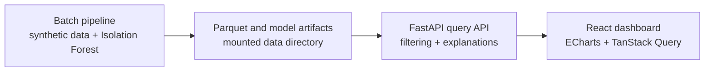

# SignalWatch

SignalWatch is a Dockerized RF anomaly-monitoring demo. It generates deterministic radio-frequency sensor observations, detects unusual behaviour with Isolation Forest, groups related detections into incidents, and explains each incident through an interactive analyst dashboard.

The MVP is intentionally a modular monolith: one batch pipeline, one read-only FastAPI service, one React dashboard, and Parquet artifacts instead of an operational database.

## Quick start

Prerequisites: Docker with Docker Compose and Make.

```bash
make demo
```

`make demo` generates the deterministic analytics artifacts only when one or more are missing, builds the containers, and starts the complete application. Open:

- Dashboard: <http://localhost:5173>
- Interactive API documentation: <http://localhost:8000/docs>
- API health: <http://localhost:8000/api/v1/health>

Stop the application with `make down`.

## Architecture



- `pipeline` generates, engineers, trains, scores, groups, evaluates, and writes artifacts.
- `api` loads artifacts once at startup and exposes versioned read-only query endpoints.
- `web` queries the API and keeps filters and incident selection synchronized across all views.
- `data/` is the only persistence layer. Generated files are ignored by Git.

The system is batch-based: generating new data and restarting the API replaces the active analysis snapshot. There is no streaming ingestor, database, or retraining interface.

## Synthetic RF data

The generator creates fourteen days of five-minute observations for three sensors and eight adjacent 433 MHz channels: 96,768 rows in total. Each row contains RSSI, SNR, noise floor, channel occupancy, packet loss, and frequency offset.

Normal data includes sensor/channel differences, time-of-day behaviour, correlated metrics, slow drift, and noise. The first seven days are clean model-training data. Twelve labelled incidents are injected into the second week only for evaluation:

- Three broadband interference incidents
- Three narrowband interference incidents
- Three signal dropouts
- Three sensor malfunctions

Synthetic labels never enter model training and are removed from observations, detections, incidents, and API responses.

Run the pipeline explicitly with:

```bash
make generate
```

For an isolated artifact directory, use `make generate DATA_DIR=/absolute/output/path`.

## Detection model and baselines

SignalWatch calculates an expected median, 5th–95th percentile normal range, and robust median-absolute-deviation scale for each sensor, channel, hour, and metric. It then engineers thirteen model features covering:

- Deviation from the relevant hourly baseline
- Five-minute signal changes
- Thirty-minute rolling volatility
- Simultaneous noise across neighbouring channels

A seed-42 Isolation Forest uses 200 estimators and `contamination=0.02`. It is fitted only on the clean first week. The user-facing alert threshold is the 99.5th percentile of clean training abnormality scores, which is deliberately more conservative than treating the model's contamination setting as the final alert rate.

## Severity and explanations

Severity is a ranked 0–100 score within the generated evaluation batch, not a probability of failure:

- Below 65: low
- 65–79.9: medium
- 80–89.9: high
- 90–100: critical

For each flagged observation, every feature is independently replaced with its normal value and the model is rescored. The reduction in abnormality estimates how much that feature drove the flag. Related features are combined into analyst-facing dimensions such as noise floor, SNR, packet loss, or cross-channel noise, and the top three are shown in the drawer.

Detections from the same sensor are grouped when they occur within ten minutes and on adjacent channels. Deterministic RF rules label the group, while templates describe the actual-versus-expected change, duration, affected channels, and whether the behaviour is isolated, sustained, or coordinated across frequencies.

## Evaluation snapshot

The deterministic seed-42 dataset currently produces:

| Metric | Result |
| --- | ---: |
| Observations | 96,768 |
| Training / evaluation observations | 48,384 / 48,384 |
| Injected-incident recall | 12 / 12 (100%) |
| Clean-observation false-positive rate | 0.77% |
| Injected root-cause classification accuracy | 100% |
| Flagged observations | 742 |
| Grouped incidents | 51 |

The grouped severity distribution is eight critical, one high, twenty-six medium, and sixteen low incidents. Metrics are written to `data/evaluation_metrics.json`; artifact counts and SHA-256 hashes are written to `data/metadata.json`.

## Query API

| Endpoint | Purpose |
| --- | --- |
| `GET /api/v1/health` | Service availability |
| `GET /api/v1/overview` | Filtered incident and anomaly summary |
| `GET /api/v1/observations` | Bounded chart series with actual and expected values |
| `GET /api/v1/anomalies` | Ranked and paginated grouped incidents |
| `GET /api/v1/anomalies/{id}` | Explanation, comparisons, contributions, and evidence |
| `GET /api/v1/heatmap` | Time-and-frequency severity cells |

Applicable endpoints accept UTC `from` and `to`, `sensor_id`, `frequency_mhz`, `min_severity`, and `incident_type`. The observation endpoint also accepts `metric` and returns at most 1,000 points while retaining anomalous readings. Invalid domains and ranges return `422`, missing incidents return `404`, and missing artifacts return `503` with recovery instructions.

## Dashboard walkthrough

The dashboard provides global time, sensor, frequency, severity, and incident-type filters. Those filters update the summary cards, signal timeline, ranked incident list, and heatmap together.

The timeline defaults to noise floor and overlays observed values, expected values, the normal range, and severity-coded incident markers. When all channels are selected globally, its labelled focus-channel control keeps the line analytically coherent while the heatmap continues to show every affected channel. Selecting a timeline marker, incident row, or heatmap cell opens the same explanation drawer.


## Loading and recovery states

The UI shows application-level loading progress, per-region skeletons, a filtered-empty explanation, partial-request warnings, a retryable service error, a dedicated missing-artifact recovery panel, and drawer-specific errors. If artifacts are unavailable outside `make demo`, run `make generate`, restart the API, and select **Try again**.

## Commands

```bash
make generate          # regenerate the default data/ artifacts
make ensure-artifacts  # generate only when an artifact is missing
make build             # build all container images
make test              # run backend and frontend tests in containers
make smoke             # verify a running API, overview query, and dashboard
make demo              # ensure artifacts, build, and start the stack
make down              # stop containers and remove orphans
```

Local frontend checks can also be run from `frontend/` with `npm run test:run` and `npm run build`. Backend checks can be run from `backend/` with `uv run pytest` and `uv run ruff check .`.

## Known limitations

- Results demonstrate behaviour on deterministic synthetic data, not production RF performance.
- Severity is batch-relative and should not be interpreted as probability, operational risk, or a calibrated real-world threshold.
- Counterfactual contributions describe model sensitivity; they are useful evidence, not proof of physical causality.
- Incident type labels use deterministic rules after Isolation Forest detection.
- The API reads a static artifact snapshot and requires restart after regeneration.
- No authentication, streaming, acknowledgement workflow, database, maps, cloud deployment, or mobile-specific layout is included.
- The frontend currently ships the full ECharts bundle; production optimization would split chart code into smaller chunks.

## Repository layout

- `backend/`: FastAPI application, analytics pipeline, and Python tests.
- `frontend/`: React, TypeScript, ECharts, TanStack Query, and frontend tests.
- `scripts/`: running-stack smoke checks.
- `data/`: generated Parquet, model, evaluation, and metadata artifacts.
- `docs/`: phase-by-phase implementation record.
- `assets/`: Stitch exports and visual inspiration, not application source code.
